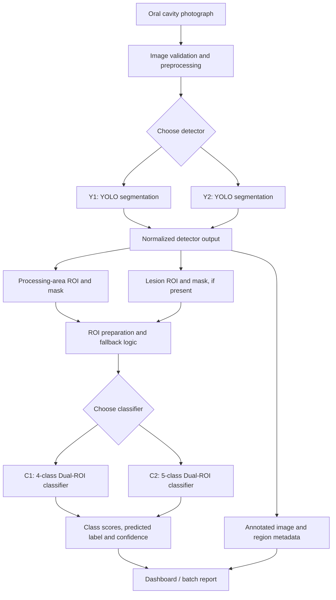
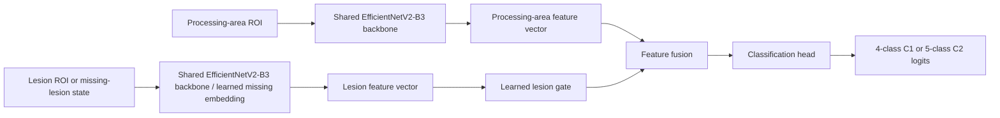
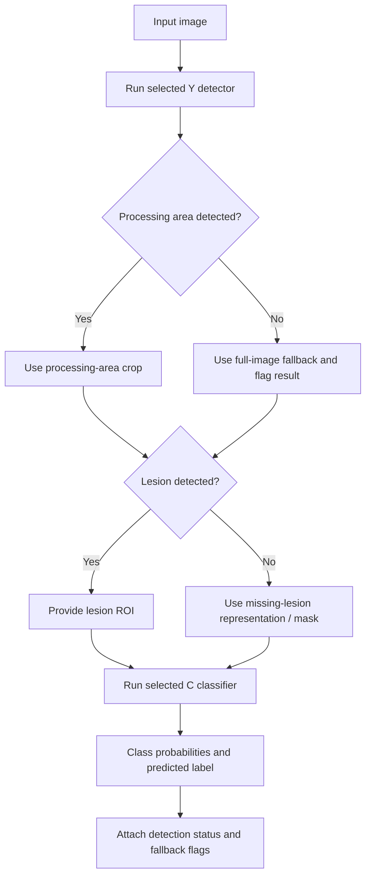

<div align="center">

# 🦷 OralScan AI
### Oral Lesion Segmentation & Multi-Class Oral Tissue Classification

**Research-oriented computer vision pipeline | YOLO instance segmentation + Dual-ROI EfficientNetV2-B3**

[Repository](https://github.com/sarfrazkhan66003/-OralScan-AI-Oral-Cancer-Detection-System) · [Architecture](#system-architecture) · [Models](#models-and-frozen-output-contracts) · [Getting Started](#getting-started) · [Safety](#clinical-and-ethical-limitations)

</div>

> [!IMPORTANT]
> **Research prototype; not a medical device or diagnostic system.** Predictions, lesion masks, confidence scores, and heatmaps do **not** establish or rule out oral cancer. Clinical assessment and, where indicated, biopsy/histopathology are required. No independently validated clinical sensitivity, specificity, or deployment authorization is claimed.

## Contents

1. [Overview](#overview)
2. [Project generations](#project-generations)
3. [System architecture](#system-architecture)
4. [Models and frozen output contracts](#models-and-frozen-output-contracts)
5. [Inference decision logic](#inference-decision-logic)
6. [Datasets and annotation formats](#datasets-and-annotation-formats)
7. [Training and evaluation](#training-and-evaluation)
8. [Repository structure and supplied artifacts](#repository-structure-and-supplied-artifacts)
9. [Getting started](#getting-started)
10. [Input, output and reporting](#input-output-and-reporting)
11. [Explainability](#explainability)
12. [Quality assurance and reproducibility](#quality-assurance-and-reproducibility)
13. [Troubleshooting](#troubleshooting)
14. [Roadmap](#roadmap)
15. [Clinical and ethical limitations](#clinical-and-ethical-limitations)
16. [Acknowledgments and license](#acknowledgments-and-license)

## Overview

OralScan AI is an experimental image-analysis project that combines **localization** of oral tissue regions and possible lesions with **classification** of selected tissue regions. Its two stages are intentionally separate:

- **Y-series (Y1 / Y2):** a YOLO instance-segmentation detector identifies the broader `processing_area` and possible `lesion` regions; returns segmentation masks, bounding boxes and confidence scores.
- **C-series (C1 / C2):** an EfficientNetV2-B3-based image classifier examines the processing-area ROI and lesion ROI (when available) and returns a disease-category probability distribution.
- **Reporting layer:** supports comparative single-image dashboards for model-pair combinations and batch PDF reports in the Colab inference workflow developed for the project. These interfaces are **not necessarily present in the public GitHub repository**.

**Main distinction:** Detecting a visible `lesion` does **not** identify its disease type. Conversely, absence of a detected lesion does **not** imply that tissue is healthy.

## Project generations

The **currently visible public GitHub README** describes an *earlier* binary classification concept using VGG16 and a lightweight CNN, with Grad-CAM illustrations. That historical README reports its own performance numbers; they should **not** be attributed to Y1/Y2/C1/C2.

| Generation | Components | Intended output | Status of evidence |
| --- | --- | --- | --- |
| Original public-repository concept | VGG16 / lightweight CNN + Grad-CAM | Cancerous vs non-cancerous and explanatory image | Described in existing public README; distinct from later architecture |
| OralScan V1 | Y1 + C1 | Region masks + four oral-tissue classes | Source notebooks, checkpoints and technical notes supplied separately |
| OralScan V2 | Y2 + C2 | Region masks + five oral-tissue classes including ulcers | Source notebooks, checkpoints and technical notes supplied separately |
| Cross-version comparison | Y1+C1, Y1+C2, Y2+C1, Y2+C2 | Comparison of detector/classifier behavior | Integration objective; validate each pair with a common adapter and aligned class schema |

## System architecture



### Inside the dual-ROI classifier



The diagram shows the **logical** pipeline; the two backbone boxes represent reused/shared feature-extraction weights, not necessarily two separate networks deployed in memory. See the supplied notebooks for exact tensor operations and layer definitions.

## Models and frozen output contracts

| Model | Role | Architecture | Class IDs / output |
| --- | --- | --- | --- |
| **Y1** | Segmentation of relevant oral region and lesions | YOLO26-M-style instance segmentation (per supplied technical documentation) | `0: processing_area`, `1: lesion` |
| **Y2** | Revised region/lesion segmentation | YOLO26-M-style instance segmentation | **Same** `0: processing_area`, `1: lesion` |
| **C1** | Four-category image classification | Dual-ROI EfficientNetV2-B3 | Four classes, in fixed order below |
| **C2** | Five-category image classification | Dual-ROI EfficientNetV2-B3 | Same first four classes, plus `Ulcers` at index 4 |

**Detector mapping — never swap these IDs:**

```python
DETECTOR_CLASSES = {0: "processing_area", 1: "lesion"}
```

**C1 classifier mapping:**

```python
C1_CLASSES = [
    "Cancer",                       # 0
    "Leukoplakia",                  # 1
    "Leukoplakia-like Conditions",  # 2
    "Normal Buccal Mucosa",         # 3
]
```

**C2 classifier mapping:**

```python
C2_CLASSES = C1_CLASSES + ["Ulcers"]  # index 4
```

**Classification model details from the supplied artifacts:**

- Backbone: `tf_efficientnetv2_b3` as provided by `timm`.
- Nominal model image size: **300 × 300** for ROI inputs.
- C1 preprocessing normalization: ImageNet mean `(0.485, 0.456, 0.406)` and std `(0.229, 0.224, 0.225)` in the referenced C1 version.
- C2 preprocessing normalization: mean and std `(0.5, 0.5, 0.5)` in the referenced C2 version.
- Dual-ROI architecture uses a processing-region representation and a lesion representation, with learned handling for an absent lesion and a gating/fusion stage.
- **Checkpoints are not interchangeable with class maps or normalizations.** Load the specific architecture and preprocessing bundled in the matching notebook/checkpoint metadata.

> [!WARNING]
> The uploaded archives contain checkpoints `ai_c1.pt`, `ai_y1.pt`, `ai_c2.pt`, and `ai_y2.pt`. Before integrating them, **inspect their embedded metadata and verify** architecture variant, class mappings, normalization, input size, calibration, and expected model loader. A `.pt` file is not a general-purpose script and untrusted PyTorch pickles can execute code during loading. Only load trusted checkpoints in a controlled environment.

## Inference decision logic



| Detector result | Classifier input behavior | Reporting note |
| --- | --- | --- |
| Processing area **and** lesion present | Processing-area ROI + lesion ROI | Record lesion/region masks and confidences |
| Processing area present, no lesion | Processing-area ROI + explicit missing-lesion pathway | Do not automatically label normal |
| Processing area missing | Full-image fallback, when enabled, with lesion ROI if available | Mark as degraded/fallback inference |
| No detections | Full-image fallback, if configured | Warn user of localization failure |

The system's historical workflow specifies that classification can still execute without a detected lesion. **The exact adapter implementation must be tested against the specific classifier checkpoint**; do not assume every old notebook implements the same final behavior.

### Pair compatibility

```text
               Classifier
              C1        C2
Detector Y1   Y1+C1     Y1+C2
         Y2   Y2+C1     Y2+C2
```

Y-series output class names and IDs are deliberately stable to support cross-pairing. This **does not guarantee equal accuracy** across pairs: detector error distributions, ROI appearance and classifier training data may differ. A robust integration should emit both the detector's stable two-label schema and the selected classifier's versioned class map.

## Datasets and annotation formats

### Y-series localization data

The supplied archives contain Roboflow-style YOLO segmentation exports grouped by lesion/source categories. The V1 archive includes cancer, leukoplakia, leukoplakia-like and processing-area sources; the V2 archive adds an ulcer-specific source. Folder names and exports reflect **source dataset identity**, not detector output categories: disease-source objects are remapped to the generic detector label `lesion`.

Typical layout:

```text
yolo_dataset/
  cancer_detection.../
    data.yaml
    train/{images,labels}/
    valid/{images,labels}/
    test/{images,labels}/
  leukoplakia_detection.../
  leukoplakia_like_detection.../
  processing_area.../
  ulcer_detection.../        # V2 source archive
```

YOLO polygon labels use normalized image coordinates:

```text
<class_id> <x1> <y1> <x2> <y2> ... <xn> <yn>
```

The final merged label IDs must be `0=processing_area` and `1=lesion` even where source datasets use different raw indices. For each image, review polygon validity, class remapping, missing/empty labels, duplicate images, and train/validation/test leakage.

### C-series classifier data

C1's supplied archive also contains a `classifier_dataset` with training/validation/test folders, class-group subfolders, paired RGB images and masks, and a `manifest.csv`. C2's supplied training notes describe a physician-reviewed ground-truth preparation workflow with five classes.

A reported **C2 ground-truth balanced split** from the associated development workflow was:

| Class | Train | Validation | Test |
| --- | ---: | ---: | ---: |
| Cancer | 85 | 29 | 30 |
| Leukoplakia | 85 | 35 | 36 |
| Leukoplakia-like Conditions | 85 | 30 | 32 |
| Normal Buccal Mucosa | 85 | 32 | 32 |
| Ulcers | 85 | 18 | 18 |
| **Total** | **425** | **144** | **148** |

The totals above describe that **specific preparation/training run**; they should not be interpreted as the file counts of either uploaded archive. The archive's source-export statistics and subsequent cleaned classifier cohort are different stages.

### Data governance

Maintain data provenance and doctor-reviewed labels, strip identifying metadata from patient images, protect original data, and keep independent patient/source groups isolated across train, validation and test. Multiple crops or augmentations of one patient must not cross splits. Review medical image-sharing permissions before placing data or model artifacts in a public repository.

## Training and evaluation

Training is primarily documented in Google Colab Jupyter notebooks. The Y series learns two-class instance segmentation; the C series learns classification using anatomically focused ROIs. These are distinct objectives and use different losses and metrics.

### Detector experiments

Evaluate instance segmentation with mask/box precision, recall and mAP, and separately track **image-level lesion detection sensitivity**. A high image-level recall does not prove accurate segmentation boundaries. The supplied Y2 development documentation distinguishes early/preliminary dataset splits from the final corrected split; its documented corrected Y2 split is **865 train / 173 validation / 115 test** for the specific merged source dataset. Validate exact counts from the notebook used to retrain.

### Classifier experiments

Track class-wise precision/recall/F1, macro-F1, confusion matrices, false-negative patterns, calibration, and performance under detector-generated (not only ground-truth) ROIs.

- **C1:** technical documentation reports **0.7431 test macro-F1** for an *earlier single-ROI baseline*; this is **not a measured final dual-ROI C1 score**.
- **C2:** an associated development run selected **epoch 22** with **validation macro-F1 ≈ 0.8194**. A separate model-analysis report also discusses a higher result under a predicted-ROI evaluation setup (~0.8406). These are different reported validation contexts; neither is an independently verified clinical test result.
- **Earlier public binary models:** the public README reports other binary-model accuracy and inference figures. Do not combine those with C-series macro-F1 numbers.

**Do not rank C1 vs C2 solely by these values:** the classes, dataset composition, evaluation cohorts, and ROI conditions may differ. A fair comparison uses a shared held-out cohort and documents how the extra `Ulcers` class is treated.

### Recommended evaluation checklist

- Freeze patient-level test partitions before model selection.
- Audit exact duplicates, derived-image lineage, and source conflicts.
- Report train/validation/test counts and demographics or acquisition setting **only if verified and permissible**.
- Compare all four model pairs on the same test images and report confidence intervals.
- Report per-class errors, especially cancer-to-normal and disease-to-normal misclassifications.
- Validate detector failure, fallback paths, out-of-distribution samples, lighting changes, and camera variation.
- Separate internal validation from external/clinical evaluation.

## Repository structure and supplied artifacts

**Visible GitHub tree at review time:**

```text
-OralScan-AI-Oral-Cancer-Detection-System/
├── README.md
├── Testing_Oral_Cancer.ipynb
├── Summary_Oral detection.pdf
└── Cancer/
```

**Separately uploaded V1 archive** (`AI_C1 and AI_Y1-...zip`):

```text
AI_C1 and AI_Y1/
├── ai_c1.ipynb
├── ai_y1.ipynb
├── ai_y1(mistake).ipynb    # historical / not recommended entry point
├── ai_c1.pt
├── ai_y1.pt
├── classifier_dataset/
├── yolo_dataset/
├── AI_C1 Doc.docx
├── AI_Y1 Doc.docx
└── Inspection_Report(AI_C1 and AI_Y1).docx
```

**Separately uploaded V2 archive** (`AI_C2 and AI_Y2-...zip`):

```text
AI_C2 and AI_Y2/
├── ai_c2.ipynb
├── ai_y2.ipynb
├── ai_c2.pt
├── ai_y2.pt
├── yolo_dataset/
├── Inspection_Report_AI_C2_and_AI_Y2.docx
├── OralScan_C2_Reverse_Engineering_Report.docx
├── AI_Y2_Reverse_Engineering_Complete.docx
└── other technical study documents
```

**Important:** The public GitHub repository and these archives are **not proven to be synchronized**. Do not present the archived `.pt` weights or newly developed four-pair dashboard as already committed to GitHub.

## Getting started

### Option A — Explore the current public repository

```bash
git clone https://github.com/sarfrazkhan66003/-OralScan-AI-Oral-Cancer-Detection-System.git
cd -- -OralScan-AI-Oral-Cancer-Detection-System
```

Open `Testing_Oral_Cancer.ipynb` in Jupyter or Google Colab. This notebook belongs to the original public-project generation; **do not expect it to load C1/C2/Y1/Y2 without adaptation**. Install dependencies indicated by that notebook's own setup cells.

### Option B — Study or run the newer archived models in Google Colab

1. Upload or mount the **trusted** V1/V2 archives in Google Drive.
2. Extract archives into separate folders; do not merge V1 and V2 datasets or overwrite source material.
3. Open and review `ai_y1.ipynb` / `ai_y2.ipynb` and `ai_c1.ipynb` / `ai_c2.ipynb`.
4. Select **Runtime → Change runtime type → GPU** if available. GPU improves training and bulk inference; availability depends on Colab plan.
5. Update notebook-specific Google Drive paths and verify checkpoint architecture, environment versions, and file naming conventions before executing cells.
6. For inference, run the provided model-loading and preprocessing cells in the correct order. Keep class-order maps and normalization settings attached to the chosen C checkpoint.
7. Validate with a de-identified example and review labels, mask overlay, confidence, warnings, and output files.

These notebooks were developed in their own Colab environments. There is **no verified, universal one-command installer** for all four checkpoints in the public repository. Do not substitute a generic YOLO/classifier loading call without confirming compatibility.

### Illustrative environment, not a pinned reproducibility lockfile

```bash
python -m venv .venv
# Windows: .venv\Scripts\activate
# macOS/Linux: source .venv/bin/activate
python -m pip install --upgrade pip
pip install torch torchvision timm ultralytics numpy pandas pillow opencv-python scikit-learn matplotlib
```

The above packages describe the broad stack, **not an exact known-good dependency version set**. For checkpoint-specific reproducibility, capture `pip freeze`, GPU details, notebook revision, data manifests, file hashes, and exact preprocessing parameters from the relevant training run.

## Input, output and reporting

**Input:** photographs of the oral cavity (e.g., JPG, JPEG, PNG). The separate project inference notebook also contemplated WEBP, BMP, TIFF and ZIP/RAR batch inputs, but the public notebook's supported formats are not verified to match that interface.

**Segmentation output:** region class ID, confidence, bounding box, polygon/mask and detection status. **Classification output:** selected C model/version, ordered class-score vector, predicted label, and preprocessing/fallback flags. Optional reporting can include visual overlays, class confidence displays and comparative reports.

Example *suggested* stable response schema (design reference, **not a claim about current notebook output**):

```json
{
  "detector_version": "Y2",
  "detector_class_map": {"0": "processing_area", "1": "lesion"},
  "classifier_version": "C2",
  "classifier_classes": [
    "Cancer", "Leukoplakia", "Leukoplakia-like Conditions",
    "Normal Buccal Mucosa", "Ulcers"
  ],
  "detections": [],
  "processing_area_found": false,
  "lesion_found": false,
  "classifier_used_full_image_fallback": true,
  "predicted_class": null,
  "class_probabilities": null,
  "warning": "Illustrative schema only; populate fields from actual inference"
}
```

A meaningful comparison dashboard should clearly identify **Y1+C1, Y1+C2, Y2+C1, and Y2+C2**, distinguish four-class from five-class predictions, include per-pair failure/warning flags, and avoid claiming a model confidence equals a clinical probability.

## Explainability

The older GitHub README discusses Grad-CAM heatmaps for binary classification. Newer Y detectors provide explicit region masks, but these **are not the same thing as Grad-CAM or explanation of the C model's decision**. A lesion segmentation mask tells the user *where a detector localized tissue*, not *why the classifier selected a disease label*. Add per-model XAI only after verifying that it is correctly implemented and its clinical usefulness has been evaluated.

## Quality assurance and reproducibility

Record a manifest for every experiment:

```text
experiment_id
notebook_commit_or_hash
checkpoint_path_and_sha256
class_mapping_and_preprocessing
source_dataset_version
patient_level_split_manifest
training_seed_and_hyperparameters
hardware_and_library_versions
validation/test_protocol
metrics_and_confusion_matrix
calibration_artifacts
known_failure_modes
```

Recommended tests include checkpoint forward pass and expected class dimension, Y output ID validation, no-lesion and missing-processing-area branches, corrupted/unsupported input rejection, ZIP/RAR extraction safety, duplicate patient detection, batch reporting consistency, and prevention of source-dataset mutation during audits.

## Troubleshooting

| Problem | Checks |
| --- | --- |
| Model checkpoint cannot load | Architecture/version mismatch, package compatibility, checkpoint integrity, trusted serialization environment |
| Predictions have wrong names | Verify frozen C1/C2 class order and 4-vs-5 output dimension |
| Detector labels appear reversed | Ensure both Y versions use `0=processing_area`, `1=lesion` |
| Predictions vary unexpectedly | Check ROI crop selection, 300×300 preprocessing, model-specific mean/std, dropout disabled in eval mode, calibration |
| No lesion identified | Use explicit missing-lesion path; report detector limitation, not “healthy” |
| No processing area identified | Apply only documented full-image fallback, flag degraded inference |
| ZIP upload error | Match upload mode to file type; validate archive members; prevent unsafe extraction paths |
| GPU unavailable / inference slow | Confirm `torch.cuda.is_available()`; CPU inference is supported where code permits but can be slower |

## Roadmap

- [ ] Publish a clean `src/` inference package with explicit Y/C adapter interfaces.
- [ ] Reproduce exact dependency versions and generate one-command smoke tests.
- [ ] Publish a **non-identifying** sample image and regression-test expected output shape.
- [ ] Compare four model pairs on one held-out, patient-independent cohort.
- [ ] Add confidence calibration and robust uncertainty/abstention handling.
- [ ] Create secure batch reporting, structured logging and model cards.
- [ ] Perform external, prospective and clinically supervised validation before any real-world healthcare use.

## Clinical and ethical limitations

- Image quality, capture device, lighting, focus, anatomical viewpoint, population characteristics, and training-data distribution may alter performance.
- Lesions and cancers can be missed; benign tissue can be flagged. Misclassification can have serious consequences.
- A category prediction is **not** a diagnosis, biopsy substitute, triage clearance, or recommended treatment.
- Confidence scores are model outputs and may be uncalibrated.
- Restrict access to medical images and remove patient identifiers; confirm consent and data-use rights.
- Only qualified clinicians should make clinical decisions. Deployment requires appropriate ethics, safety, privacy and regulatory review.

## Acknowledgments 

Project repository maintained at [sarfrazkhan66003 / OralScan AI](https://github.com/sarfrazkhan66003/-OralScan-AI-Oral-Cancer-Detection-System). The technical description above is based on the publicly visible repository README plus the separately supplied Y1/C1 and Y2/C2 archives, including notebooks and study documents.

